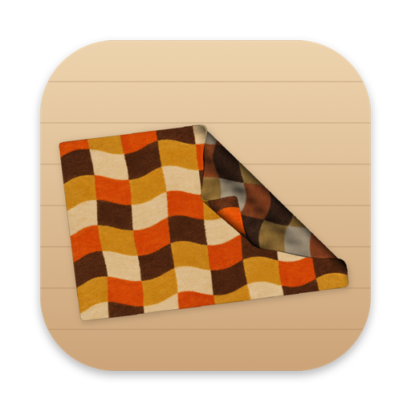
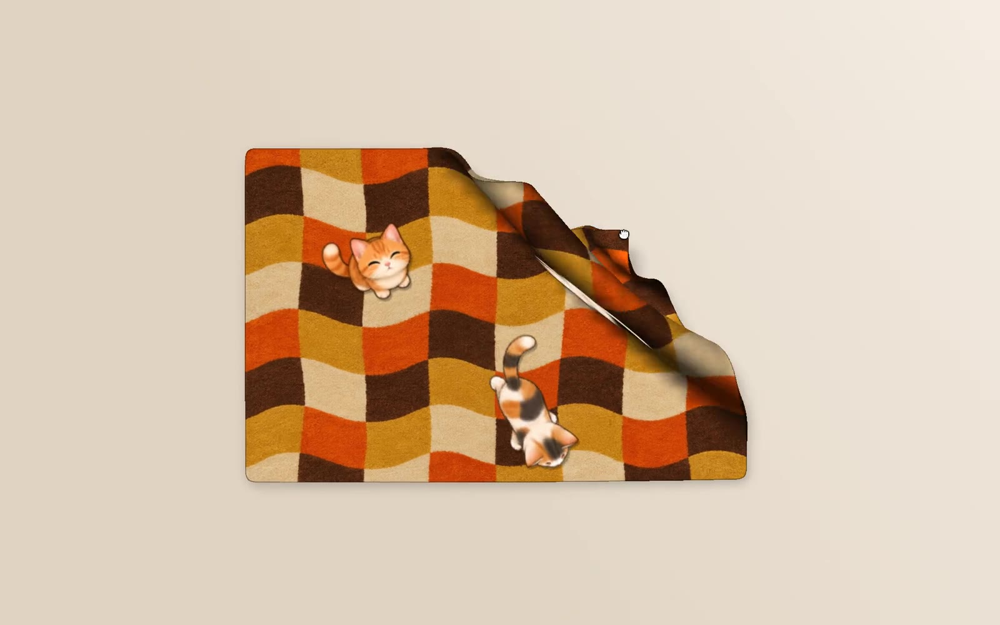

<div align="center">



# Desktop Rug

A soft, heavy rug for the Mac desktop. Sweep the mess under it.

[**Download for Mac**](https://github.com/t42ji2ji/desktop-rug/releases/latest/download/DesktopRug.dmg) · [Website](https://rug.dorara.app) · [中文](README.zh-TW.md)

<a href="https://rug.dorara.app"></a>

</div>

## What it does

- **A real piece of cloth.** Grab any edge and the rug lifts, folds and drops back with weight. Flip a corner over, then pull it back flat.
- **Covers the desktop, not the work.** The rug lies on the desktop, under every window. Files underneath stay hidden until a corner is lifted.
- **Bumps over piles.** Icons under the rug push it up; the taller the pile, the bigger the bump.
- **Cats.** Up to four cats live on the rug. They wander, roll over for belly rubs, scratch, and sit to look up at the screen. Pick one up and put it somewhere else.
- **Any pattern.** Eight rugs come built in, and any image can become a rug.

## Install

1. Download [DesktopRug.dmg](https://github.com/t42ji2ji/desktop-rug/releases/latest/download/DesktopRug.dmg).
2. Open it and drag **Desktop Rug** into **Applications**.
3. Open Desktop Rug. It lives in the menu bar (the checkered icon) — there is no Dock icon.

Requires macOS 14 or later on Apple Silicon.

## How to use

| Do this | What happens |
|---|---|
| Drag the middle of the rug | Slides the whole rug along |
| Drag an edge or corner | Lifts and folds that part |
| Right-click the rug | Opens the edit bar: resize from the corners, move, change pattern, choose cats |
| Hold ⌥ (Option) | Same edit bar, only while the key is held |
| Click **+** in the edit bar | Use an image from the Mac as the rug |
| Drag a cat | Picks it up and puts it down somewhere else |
| Trash icon in the edit bar | Folds the rug up and puts it away |

Everything else is in the menu bar icon: lay the rug back out, move it to the center of the screen, adjust how heavy and stiff it feels, and quit.

The rug can be dragged between displays.

## Good to know

- **"Desktop Rug wants to control Finder."** On first launch macOS asks for this. It is only used to read where the desktop icons are, so the rug can bump up over them. Saying no is fine; the rug just stays flat.
- Bumps need desktop icons to be shown. If they are turned off in Finder, the rug stays flat.
- Icons fully covered by the rug can't be clicked. Move the rug or lift a corner to reach them.
- Images added with **+** are kept in `~/Library/Application Support/DesktopRug/patterns`.

## Uninstall

Quit from the menu bar icon, then move Desktop Rug from Applications to the Trash. To also remove added images, delete `~/Library/Application Support/DesktopRug`.

## Credits

Inspired by [Terkel's desktop rug](https://x.com/terkelg/status/2107540718461886464) ([desktop.cleaning](https://desktop.cleaning)). This is an independent remake, not affiliated with the original.

Rug patterns and cats were drawn with ChatGPT image generation.

## Build from source

```sh
./build.sh && open build/DesktopRug.app
```

## License

[GPL-3.0](LICENSE)
